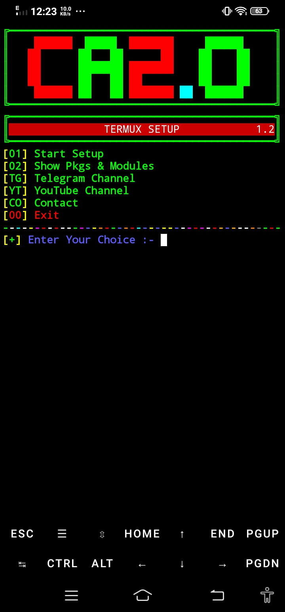
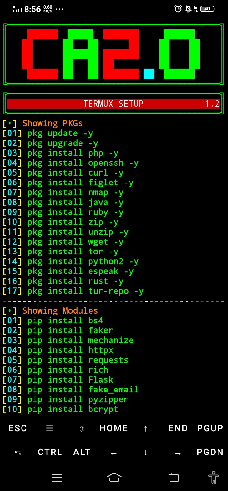
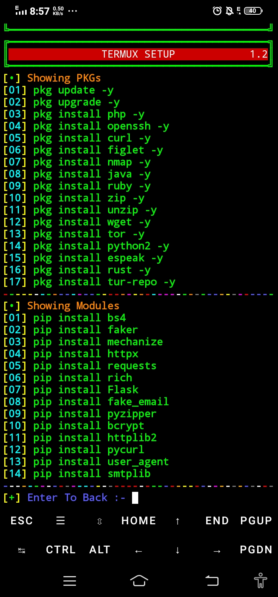
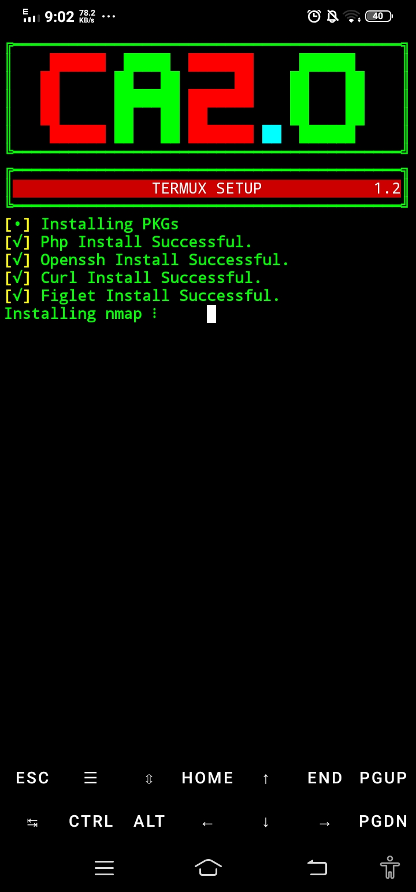

<h1 align="center">⚙️ TERMUX SETUP</h1>

<p align="center">
  A simple Termux tool that automatically installs all required packages & Python modules needed for development — in one run.
</p>

<p align="center">
  <a href="https://youtube.com/@cyber_army_2.0"></a>
</p>
<p align="center">
  <a href="https://t.me/Cyber_Army_2_0"></a>
</p>

<p align="center">
  <a href="https://t.me/Cyber_Army_Chat_Bot">
    
  </a>
</p>

---

## 📥 Installation

```bash
pkg update -y
pkg upgrade -y
pkg install python -y
pkg install git -y
git clone https://github.com/cyber-army-20/TERMUX-SETUP
cd TERMUX-SETUP
python setup.py
```

---

## 📦 What Gets Installed

**Packages:**
`php` `openssh` `curl` `figlet` `nmap` `java` `ruby` `zip` `unzip` `wget` `tor` `python2` `espeak` `rust` `tur-repo`

**Python Modules:**
`bs4` `faker` `mechanize` `httpx` `requests` `rich` `Flask` `fake_email` `pyzipper` `bcrypt` `httplib2` `pycurl` `user_agent` `smtplib`

---

## 🖼️ Screenshots

<table>
  <tr>
    <td></td>
    <td></td>
    <td></td>
    <td></td>
  </tr>
</table>

> Add your preview images inside a `screenshots/` folder in this repo and update the paths above. Add as many `<td></td>` cells as you need — GitHub auto-scrolls wide tables horizontally.

---

## 📞 Contact & Support

If you have any questions or need assistance, feel free to contact through our Telegram bot:

<p align="center">
  <a href="https://t.me/Cyber_Army_Chat_Bot">
    
  </a>
</p>

---

<p align="center">Made with ❤️ using Python & Termux</p>
